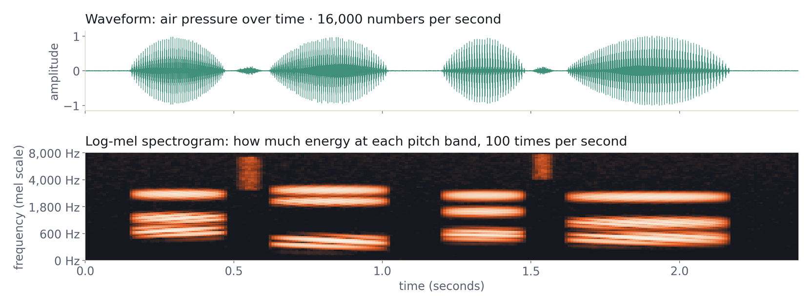
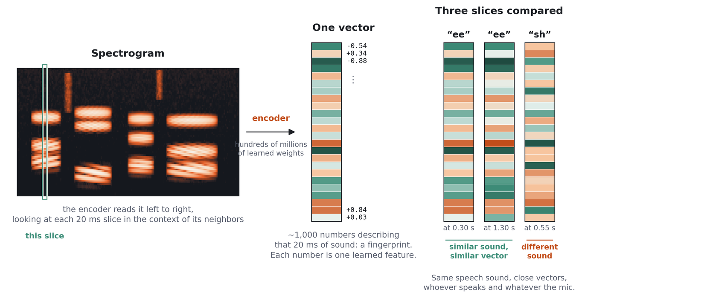
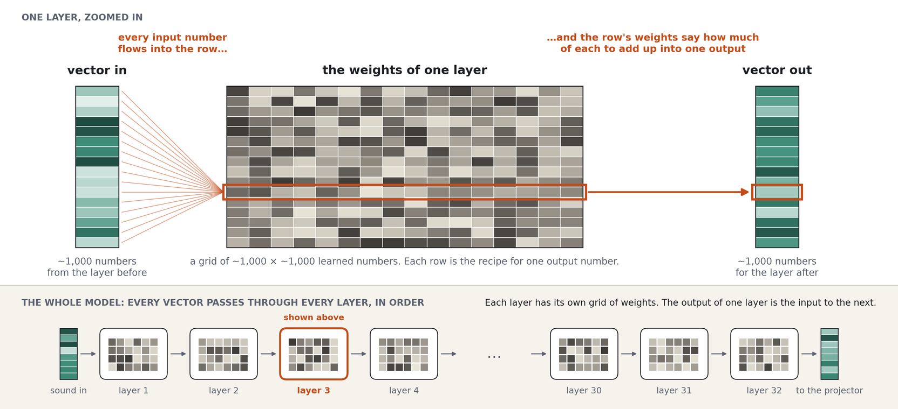
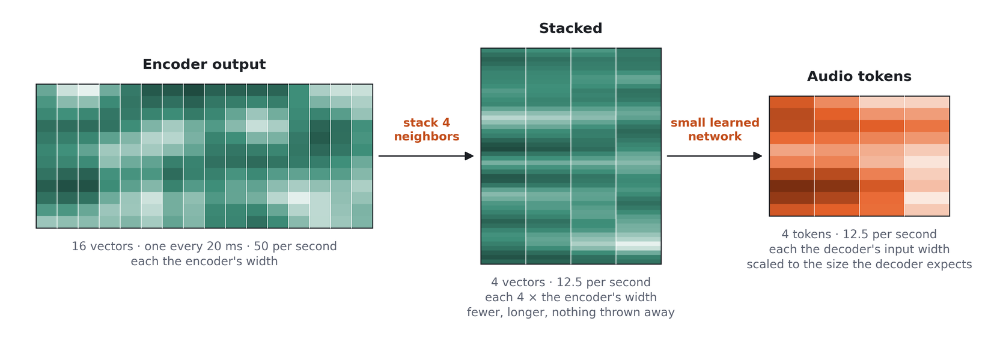
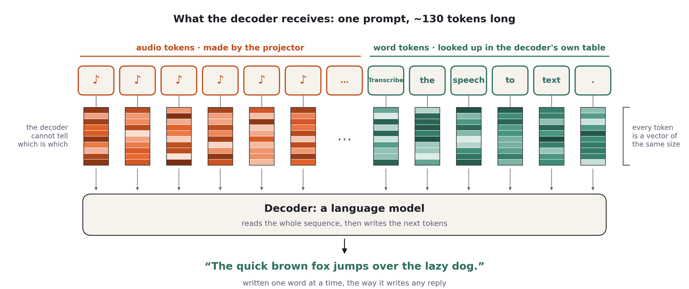

# Class 1: Introduction and Setup

**Time:** 1.5 hours (40 min lecture + 50 min hands-on)

**Goal**: Understand the architecture well enough to predict tensor shapes, then get the published
model running on your machine.

______________________________________________________________________

## Part A: Lecture (40 min)

### What is ASR?

Automatic Speech Recognition converts speech to text. Two kinds of variability make it hard:

- **Acoustic**: accents, background noise, microphone quality, speaking rate
- **Linguistic**: homophones ("to" vs "two"), punctuation, capitalization, names and numbers

Keep that split in mind; it is the most useful idea in this class. Almost every mistake a recognizer
makes is either a **hearing mistake** (it misheard the sound) or a **language mistake** (it heard
fine but chose the wrong word, spelling, or number format). The architecture below has one part for
each skill, so when a transcript is wrong you can usually tell which part misfired. A mumbled name
turned into a different word is the ear; "there" instead of "their" is the language model.

The classic answer was to train one big model end to end on thousands of hours of audio. Tiny Audio
takes a cheaper route: borrow a model that already understands audio, borrow a model that already
understands language, and train a small bridge between them.

### The Architecture

```text
Audio → Log-mel spectrogram → Encoder → Projector → Decoder → Text
        (preprocessing)       (frozen)  (trained)   (fine-tuned)
```

| Piece       | Role                | Job                                                              |
| ----------- | ------------------- | ---------------------------------------------------------------- |
| Spectrogram | The picture         | Turn raw sound into an image of which pitches are present when   |
| Encoder     | The ear             | Work out which speech sounds were made, whoever said them        |
| Projector   | The translator      | Hand what the ear heard to the language model in a form it reads |
| Decoder     | The language expert | An ordinary chat-style language model that writes the transcript |

**Log-mel spectrogram**: a fixed recipe, nothing learned. See
[From Sound to a Spectrogram](#from-sound-to-a-spectrogram).

**Encoder (GLM-ASR-Nano-2512, encoder only)**: a 32-layer Transformer that turns a spectrogram into
one 1280-dimensional vector every 20 ms. It already knows what speech sounds like. We keep it
frozen: its weights never change.

**Projector (MLP)**: the bridge. It compresses the encoder's frames and maps them into the decoder's
embedding space so they look like word embeddings. This is the one component we build from scratch.

**Decoder (Qwen3-0.6B)**: a language model. Given the projected audio "tokens" and a short text
prompt, it writes the transcript, handling spelling, punctuation, and grammar. We fine-tune it
gently so it learns to read the projector's output.

### Why This Works

| Component          | Params | During training      | Learning rate |
| ------------------ | ------ | -------------------- | ------------- |
| GLM-ASR encoder    | ~635M  | Frozen               | none          |
| MLP projector      | ~6.3M  | Trained from scratch | 1e-3          |
| Qwen3-0.6B decoder | ~600M  | Fine-tuned           | 2e-5          |

- The encoder was already trained for ASR, so its features carry nearly everything we need.
- The gap between "audio features" and "text embeddings" is narrow enough that a two-layer MLP can
  bridge it.
- The decoder's learning rate is 50x lower than the projector's. It nudges, it doesn't relearn. That
  keeps Qwen3's language knowledge intact while it adapts to the new input.

An earlier version of this recipe froze the decoder too and trained only the projector. The current
default trains both jointly because the joint gradient is what keeps improving the loss after the
first few hundred steps. You can still run the frozen-decoder variant with one flag
(`training.freeze_language_model=true`).

### From Sound to a Spectrogram



Sound is a wave of air pressure, and a digital recording is a long list of pressure readings: 16,000
of them per second at Tiny Audio's sample rate. That **waveform** (top) shows *when* someone talks,
but what makes "ba" different from "da" is buried in wiggles far too fast to see, and too fast for a
model to pick out of raw readings.

The **log-mel spectrogram** (bottom) asks, 100 times a second, how much energy there is at each
pitch, low to high. Vowels become horizontal stripes, consonants become short, high, fuzzy smears,
and each speech sound gets a visible signature. Two details make it "see like an ear":

- **Mel spacing.** The 128 frequency bands are spaced the way human hearing is: fine at low pitches,
  coarse at high ones.
- **Log scale.** Energies are compressed so loud vowels don't drown out soft consonants.

Nothing in this step is learned; it is the same fixed recipe for every clip. And a spectrogram is a
grid of brightness values, time across and pitch up, which is exactly what a grayscale image is.
That is no coincidence: speech models borrowed their tools from image models.

### What the Encoder Produces



For every 20 ms slice (two spectrogram frames), the encoder emits one **vector**: a list of 1280
numbers. That length is the model's *width*: every layer inside the encoder reads a list of 1280 and
writes a list of 1280, so the output vector is the model's working unit, not something bolted on at
the end.

No single number means anything on its own; the pattern across all 1280 is a fingerprint of that
moment of sound. The useful property is in the right-hand panel: the same speech sound gets nearly
the same vector whoever says it and whatever the microphone, while different sounds get different
vectors. The encoder has learned to ignore *who* and *how*, and keep *what*.

### Weights vs. Vectors



"635M parameters" and "1280-dimensional vectors" are different numbers, and it's worth being clear
about why.

- **A weight is a learned number.** A layer holds grids of them, each roughly 1280 × 1280.
- **Each row of a grid is a recipe.** To make one output number, multiply every input number by the
  weight in that row and add them up. Do that for every row and you have a new vector. This is the
  matrix multiplication from high-school algebra, just enormous: `nn.Linear` in PyTorch.
- **Layers stack.** The encoder has 32 layers, each with several grids. Every vector passes through
  all of them in order; the output of layer 1 is the input to layer 2.

One 1280 × 1280 grid is about 1.6M weights. Several grids per layer, 32 layers, and you reach
hundreds of millions. The vectors stay 1280 numbers wide the whole way; there are just a lot of
grids to pass through. Training is how weights get their values. Once trained (or frozen, like our
encoder) they are the same for every clip. **Weights stay; vectors flow.**

### How the Projector Works



The encoder and decoder were trained separately, so their vectors don't match: different lengths
(1280 vs 1024) and different number ranges. The projector is the adapter. It makes the sequence
**fewer** (stack 4 neighbors), **reshapes** each stacked vector to the decoder's width with a small
learned network, and **scales** it to the magnitude the decoder expects. Each resulting **audio
token** covers about 80 ms of sound, roughly a syllable: not a word, not a letter, but a chunk of
sound written in the decoder's language of numbers. Nobody designed what an audio token means;
training settles on whatever packing helps the decoder write the right words.

Follow a 10-second clip through the pipeline:

| Stage                        | Rate             | Shape for 10 s | Notes                                |
| ---------------------------- | ---------------- | -------------- | ------------------------------------ |
| Waveform                     | 16,000 samples/s | 160,000        | Resampled to 16 kHz if needed        |
| Log-mel spectrogram          | 100 frames/s     | 128 × 1000     | 128 mel bins                         |
| Encoder output               | 50 frames/s      | 500 × 1280     | One conv layer halves the frame rate |
| After frame stacking (k = 4) | 12.5 tokens/s    | 125 × 5120     | 4 adjacent frames concatenated       |
| Projector output             | 12.5 tokens/s    | 125 × 1024     | Matches Qwen3-0.6B's embedding size  |

The projector itself is:

```text
RMSNorm(5120) → Linear(5120 → 1024) → GELU → Linear(1024 → 1024) → × fixed output scale
```

Two ideas to remember:

1. **Frame stacking (downsampling)**. Concatenating `k` adjacent frames along the feature axis cuts
   the sequence length by `k` and gives each token more context. The output length is:

   ```text
   output_length = (input_length - k) // k + 1
   ```

   With `k = 4`, 500 encoder frames become 125 audio tokens. Fewer tokens means the decoder does
   less work and its attention sees a shorter sequence.

1. **Output scale**. The last linear layer's output is multiplied by a fixed constant that is
   calibrated once, at model creation, so the projector's output has the same magnitude as Qwen3's
   word embeddings. Without it the audio tokens arrive about 13x too "loud" and the decoder's layers
   barely modify them.

Parameter count with the defaults: about 5.2M in the first linear layer, about 1.05M in the second,
plus a 5120-element norm. Roughly 6.3M total.

### How the Decoder Sees Audio



A language model never sees words either. Text is first split into **tokens** (a word or part of
one), and each token ID is looked up in the **embedding table** (`embed_tokens`, 151,936 rows × 1024
columns for Qwen3-0.6B). What the first layer actually receives is a row of 1024-number vectors. The
projector emits vectors of exactly that width, so audio tokens slot into the same row as word
tokens, and the decoder has no way to tell them apart.

The decoder never sees a spectrogram. It sees a normal chat conversation whose user turn contains
placeholder tokens:

```text
<|im_start|>user
<audio><audio><audio> ... (125 of them) ... Transcribe the speech to text<|im_end|>
<|im_start|>assistant
The quick brown fox jumps over the lazy dog.<|im_end|>
```

Before the decoder runs, the model swaps each `<audio>` placeholder's embedding for one row of the
projector's output. From the decoder's point of view it is completing a chat where the user pasted
125 unusual words and asked for a transcript. Training loss is computed only on the assistant turn.

This is why the chat template matters: Qwen3-0.6B ships with one, and the training collator depends
on it.

______________________________________________________________________

## Part B: Hands-On (50 min)

### Exercise 1: Environment Setup (15 min)

**Create accounts** (if you haven't yet):

| Account          | URL                                      | Purpose                   |
| ---------------- | ---------------------------------------- | ------------------------- |
| GitHub           | [github.com](https://github.com)         | Code                      |
| Hugging Face     | [huggingface.co](https://huggingface.co) | Models and demos          |
| Weights & Biases | [wandb.ai](https://wandb.ai)             | Training curves (Class 2) |

**Install:**

```bash
# Prerequisites: the project requires Python 3.12 exactly
python3.12 --version
git --version

# Clone the repo
git clone https://github.com/alexkroman/tiny-audio.git
cd tiny-audio

# Install Poetry (macOS)
brew install poetry

# Or with pip (any platform)
pip install poetry

# Install dependencies (several GB: PyTorch, transformers, gradio, ...)
poetry install

# Verify
poetry run python -c "import torch; print(f'PyTorch {torch.__version__}')"
poetry run ta --help
```

**Log in to Hugging Face** so downloads and later uploads work:

```bash
poetry run hf auth login
```

(Older installs call this `huggingface-cli login`.) Alternatively export `HF_TOKEN` in your shell.

If Python 3.12 is missing, install it with `pyenv install 3.12` or `brew install python@3.12` and
run `poetry env use python3.12` before `poetry install`.

### Exercise 2: Run Inference (15 min)

**Launch the demo:**

```bash
poetry run ta demo --model mazesmazes/tiny-audio
```

Open [http://localhost:7860](http://localhost:7860). Record yourself or upload a file. The first run
downloads about 6 GB (the model plus the encoder's repo) and takes a minute to load.

**Run from Python:**

```python
from transformers import pipeline

pipe = pipeline(
    "automatic-speech-recognition", model="mazesmazes/tiny-audio", trust_remote_code=True
)
result = pipe("path/to/audio.wav")
print(result["text"])

# Word-level timestamps
result = pipe("path/to/audio.wav", return_timestamps=True)
print(result["words"])
```

`trust_remote_code=True` is required because the model's architecture lives in the repo's own Python
files (`asr_modeling.py`, `projectors.py`, ...), which are published alongside the weights.

**Run a small evaluation:**

```bash
poetry run ta eval -m mazesmazes/tiny-audio -n 20
```

This downloads 20 clips from the LoquaciousSet test split, transcribes them, and prints the
reference and prediction for each along with its Word Error Rate (WER). Lower is better. Class 3
covers this in depth.

### Exercise 3: Explore the CLI (10 min)

The `ta` command (short for `tiny-audio`) groups every tool in the repo:

```bash
poetry run ta --help            # all command groups
poetry run ta eval --help       # evaluation options
poetry run ta debug --help      # gradient-flow check
poetry run ta runpod --help     # cloud training (Class 2)
poetry run ta dev --help        # lint, test, format
```

Try:

```bash
# Which datasets can you evaluate on? Read the help text for -d
poetry run ta eval --help

# Run the test suite (a couple of minutes)
poetry run ta dev test
```

### Exercise 4: Trace the Data (10 min)

`docs/course/examples/trace_data.py` pushes one LibriSpeech clip through the published model and
records the tensor at every stage: waveform, spectrogram, encoder output, projector output. It also
finds, for each projected audio token, the nearest real word embedding in Qwen3's vocabulary, which
shows how "text-like" the projector's output has become.

```bash
poetry run python docs/course/examples/trace_data.py
```

It writes `docs/course/examples/data_trace.html`. Open it in a browser and check the shapes against
the table in the lecture. (A pre-generated copy is checked in if you'd rather just read it.)

______________________________________________________________________

## Understanding the Code

### Key Files

| File                           | Purpose                                                                                    |
| ------------------------------ | ------------------------------------------------------------------------------------------ |
| `tiny_audio/asr_modeling.py`   | `ASRModel`: loads the encoder and decoder, builds the projector, runs forward and generate |
| `tiny_audio/projectors.py`     | `MLPAudioProjector` and the frame-stacking helpers                                         |
| `tiny_audio/asr_config.py`     | `ASRConfig`: every model setting, with defaults                                            |
| `tiny_audio/asr_processing.py` | `ASRProcessor`: feature extractor plus tokenizer                                           |
| `tiny_audio/asr_pipeline.py`   | The `transformers` pipeline used for inference                                             |
| `scripts/train.py`             | Training entry point: dataset loading, label normalization, and the trainer                |
| `scripts/train_collator.py`    | The data collator: chat messages, loss masking, and label filtering                        |
| `scripts/eval/`                | Dataset registry and evaluators (local models and commercial APIs)                         |
| `configs/`                     | Hydra configuration                                                                        |

Worth reading in this order: the `MLPAudioProjector` class, then `ASRModel.forward`, then
`DataCollator._make_messages` in `scripts/train_collator.py`.

### Configuration System

Training is configured with [Hydra](https://hydra.cc/). The main file is `configs/config.yaml`.
Experiments layer overrides on top of it, and you can override any single value on the command line
with `key=value` syntax (not `--key value`):

```bash
# Run the production recipe
poetry run python scripts/train.py +experiments=stage_1

# Same recipe, different projector width
poetry run python scripts/train.py +experiments=stage_1 model.projector_hidden_dim=2048

# Local smoke test on a tiny dataset
poetry run python scripts/train.py +experiments=mps_smoke
```

```text
configs/
├── config.yaml               # Model defaults: GLM-ASR encoder, Qwen3-0.6B, MLP projector
├── training/production.yaml  # Trainer defaults: LRs, batch size, schedule, checkpointing
├── data/
│   ├── multiasr.yaml         # Production mix: 10 corpora, ~3M clips
│   └── librispeech_dummy.yaml  # 73 clips, for smoke tests
└── experiments/
    ├── stage_1.yaml          # Production recipe (frozen encoder, joint projector + decoder)
    ├── granite_qwen_frozen.yaml  # Published model: Granite Speech encoder + LoRA on Qwen3.5
    └── mps_smoke.yaml        # 10 steps on a laptop
```

The comments in these YAML files are unusually detailed. They record why each value is what it is
and which experiment changed it. Read `configs/experiments/stage_1.yaml` before Class 2.

______________________________________________________________________

## Troubleshooting

| Problem                                  | Solution                                                             |
| ---------------------------------------- | -------------------------------------------------------------------- |
| `poetry install` fails on Python version | The project needs 3.12. Install it, then `poetry env use python3.12` |
| `poetry install` hangs                   | `poetry install -vvv` for verbose output                             |
| Model download fails                     | Check `HF_TOKEN`, or run `poetry run hf auth login`                  |
| Port 7860 in use                         | `poetry run ta demo --port 7861`                                     |
| Import errors                            | Run `poetry install` again                                           |
| Slow inference on a laptop               | Normal on CPU. Apple Silicon uses MPS automatically                  |
| `flash_attention_2` warning              | Expected off CUDA. The model falls back to SDPA attention            |

______________________________________________________________________

## Key Takeaways

1. **Architecture**: frozen encoder, projector trained from scratch, decoder fine-tuned gently.
1. **Shapes**: 50 encoder frames/s at 1280 dims become 12.5 audio tokens/s at 1024 dims.
1. **The trick**: the decoder sees a chat whose user turn is audio tokens plus a prompt.
1. **Tools**: the `ta` CLI wraps evaluation, analysis, training, and deployment.

## Before Class 2

You should leave this class with:

- [ ] `poetry run ta --help` working
- [ ] The demo transcribing your voice
- [ ] A 20-sample eval run finished (it warms the dataset cache too)

To prepare:

- [ ] Read the comment block at the top of `configs/experiments/stage_1.yaml`
- [ ] Create a RunPod account and add credit for a few GPU-hours
- [ ] Create a Hugging Face **write** token (Settings → Access Tokens); Class 2 pushes checkpoints
  to your account
- [ ] Decide which budget tier from the [course overview](./0-course-overview.md#budget) you'll run

______________________________________________________________________

[← Course Overview](./0-course-overview.md) | [Class 2: Training →](./2-training.md)
