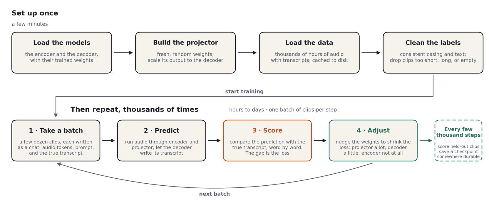
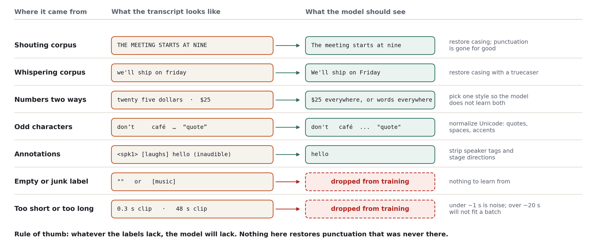

# Class 2: Training

**Time:** 1 hour of class time (20 min lecture + 40 min hands-on), then the run continues on its own

**Goal**: Size a cloud GPU, write your own experiment config, and launch a real training run.

> **Before you start.** You need the install from Class 1, a Hugging Face **write** token, a W&B
> account, and a RunPod account with credit. Have `configs/config.yaml` and
> `configs/training/production.yaml` open; together they are the default recipe the lecture refers
> to.

______________________________________________________________________

## Part A: Lecture (20 min)

### What `scripts/train.py` Does



Every run has the same two parts, whether it's an afternoon on one rented GPU or weeks on hundreds:
set up once, then loop. Each pass through the loop takes a batch of clips, lets the model predict
their transcripts, boils the gap between prediction and truth down to one number (the **loss**, a
penalty score that's near zero for a perfect transcript), and nudges the weights to lower it: the
projector a lot, the decoder's LoRA adapters a little, the encoder and the decoder's own weights not
at all. In detail:

1. **Loads the two pretrained models** from the Hub: the Granite Speech encoder and Qwen3.5-2B. Both
   are frozen, so their weights are stored in bfloat16 (`model_dtype: bfloat16`). The parts that
   train, the projector (`projector_dtype: float32`) and the LoRA adapters, keep float32 weights so
   tiny updates aren't rounded away; compute runs in bfloat16.
1. **Builds a fresh projector**, calibrates its output scale against the decoder's embedding table,
   and wraps the decoder's linear layers with LoRA adapters (rank 64, alpha 64, `all-linear`).
1. **Loads the datasets** listed in the data config. This is a normal `load_dataset()` in map mode,
   not streaming: everything is downloaded and cached to disk, and `datasets` keeps two copies (the
   Hub download plus its own Arrow tables). Budget about twice the download size.
1. **Normalizes labels.** Corpora that ship all-lowercase or all-uppercase transcripts are re-cased
   with a statistical truecaser so the decoder sees one consistent format. Unicode is cleaned up.
   Clips shorter than 0.8 s or longer than 19 s are dropped, as are rows whose label normalizes to
   nothing.
1. **Collates batches** into chat-template conversations (see Class 1): audio placeholders plus a
   prompt in the user turn, the transcript in the assistant turn. Loss is computed on the assistant
   turn only.
1. **Trains** with the Hugging Face `Trainer` and AdamW. Three parameter groups get three learning
   rates: projector 1e-3, decoder (the LoRA adapters) 1e-4, encoder none (frozen). 1,000 warmup
   steps, then a cosine decay to zero, gradient clipping at 1.0, bf16.
1. **Evaluates and checkpoints** every 2,000 steps. With `push_to_hub: true` every checkpoint is
   uploaded to your Hub repo as it is saved, so you can evaluate mid-run from any machine.

### Data: Make the Labels Agree

The loop is simple. What makes or breaks a run is what you feed it, and two things matter.

**The mix.** A model trained only on audiobooks falls apart in a meeting. Combine read and
spontaneous speech, clean and noisy recordings, and many accents, weighted toward where the model
will be used. That is why the production recipe trains on `multiasr`, a blend of 10 corpora, and why
the smaller single-corpus run you launch in this class will be weaker on some domains than others.

**Consistency.** Every corpus writes its transcripts differently, and a model trained on all of them
unchanged learns all of their habits: its output flickers between styles at random. Step 4 above
picks one style and makes every label match it:



(In the code the exact length limits are 0.8 s and 19 s.)

One rule of thumb: **whatever the labels lack, the model will lack.** A truecaser can put capital
letters back, but punctuation nobody wrote down is gone for good. If you want the model to
punctuate, some of its training data must be punctuated. And always keep held-out clips the model
never trains on; that is the only honest test, and it is what the eval loss below measures.

### Key Metrics

| Metric            | W&B name                         | What to look for                                             |
| ----------------- | -------------------------------- | ------------------------------------------------------------ |
| **Training loss** | `train/loss`                     | Cross-entropy on the assistant turn. Falls fast, then slowly |
| **Eval loss**     | `train/eval_loss` or `eval/loss` | Same quantity on held-out clips. Should track training loss  |
| **Gradient norm** | `train/grad_norm`                | Settles after warmup; the default clips at 1.0               |
| **Learning rate** | `train/learning_rate`            | Ramps up over warmup, then decays along a cosine             |

Signs of trouble:

- Training loss flat after a few hundred steps: learning rate too low, or the data isn't reaching
  the model (check label normalization output).
- Eval loss rising while training loss falls: overfitting. Shorten the run or add data.
- Gradient norm spiking above 100: instability. Check for bad samples or lower the LR.
- `NaN`: one corrupt clip is enough. The collator filters the common cases; if it happens, find the
  batch.

### What Convergence Looks Like

The projector starts as random noise, so early on the decoder receives garbage and the loss is high.
The curve below was recorded on the earlier GLM-ASR + Qwen3-0.6B recipe (a full decoder fine-tune)
on the production mix; the default Granite + Qwen3.5-2B + LoRA recipe has not been charted step by
step here, so treat the numbers as the expected shape rather than targets:

- **Steps 0 to ~500**: loss falls from ~3.5 to under 1.0 as the projector finds the basic
  audio-token-to-word mapping. Transcripts go from gibberish to recognizable within this window.
- **Steps ~500 to ~1,500**: loss settles toward ~0.4 and the gradient norm stabilizes.
- **After that**: slow, steady improvement for the rest of the run, as the decoder side (full
  fine-tune there, LoRA adapters in the default) does most of the work.

Earlier versions of this course described a "cliff" around step 1,500 where the model suddenly
started working. That was a projector-only recipe. Once the decoder side trains too, the transition
comes much earlier and is less abrupt. On a smaller dataset with a smaller batch, expect the same
shape stretched or compressed along the step axis.

### The Recipe

There is one recipe, and it is the default: `configs/config.yaml` plus
`configs/training/production.yaml`. No experiment presets ship in the repo.

| Encoder                      | Decoder             | What trains                     | Data       |
| ---------------------------- | ------------------- | ------------------------------- | ---------- |
| Granite Speech 470M (frozen) | Qwen3.5-2B (frozen) | Projector + decoder LoRA (~80M) | `multiasr` |

Every variant is the same code with different freeze flags and model IDs. The flags:

| Flag                                | Default | Meaning                                                           |
| ----------------------------------- | ------- | ----------------------------------------------------------------- |
| `training.freeze_audio_encoder`     | `true`  | Encoder weights never change                                      |
| `training.freeze_language_model`    | `true`  | Decoder base weights never change (LoRA adapters still train)     |
| `training.freeze_text_embed_tokens` | `true`  | Keep the decoder's embedding table fixed (protects rare tokens)   |
| `training.freeze_projector`         | `false` | Set `true` to train LoRA adapters alone                           |
| `model.use_lora`                    | `true`  | LoRA adapters on the decoder (`training.use_lora` overrides this) |

**LoRA** (Low-Rank Adaptation) adds small trainable matrices next to the decoder's linear layers and
leaves the original weights untouched. The default puts rank-64 adapters on every linear layer of
Qwen3.5-2B: ~67M trainable parameters instead of ~1.9B. The alternatives are one override away:

```bash
# Projector only: no adapters, decoder fully frozen
poetry run python scripts/train.py training.use_lora=false

# Full decoder fine-tune instead of LoRA. Needs far more memory than the default sizing, so run
# `ta runpod plan` with the same overrides first. The default stores the decoder in bf16 because
# it is frozen; for a trainable decoder, consider `model.model_dtype=float32` so small updates
# aren't rounded away.
poetry run python scripts/train.py training.freeze_language_model=false training.use_lora=false
```

______________________________________________________________________

## Part B: Hands-On (40 min)

The course run uses the default 2B decoder, sized for one 80 GB GPU, so it trains on a rented GPU.
Exercises 1 and 2 (sizing and writing your config) still run on your laptop, and so does Exercise 0:
a free rehearsal of the whole loop before you spend anything.

### Exercise 0: The Free Run (optional, ~30 min unattended)

`configs/experiments/tiny.yaml` is the default recipe with the smaller Qwen3.5-0.8B decoder, trained
on LibriSpeech dev-clean (5.4 hours, a ~340 MB download). It peaks at 8-10 GB of GPU memory, so it
runs on a 16 GB Apple Silicon Mac or any CUDA GPU, including a free Colab T4. Nothing leaves your
machine: no W&B, no Hub, no RunPod.

```bash
poetry run ta train asr -e tiny
```

Watch the loss in the log. It sits near 4 while the projector's output is still noise to the
decoder, then drops below 1 somewhere around step 400-650 as the decoder starts reading the audio.
That drop is the moment the encoder and the decoder start talking to each other; the cloud run below
shows the same curve on far more data. When it finishes, read what it learned:

```bash
poetry run ta eval -m outputs/tiny --local-code -d librispeech -n 20
```

Expect about 16% WER, with mistakes like "furnishings" for "furniture". Start it before Exercise 1
and it trains while you work through the rest of the class.

### Exercise 1: Size Your Cloud Run (5 min)

Never guess at GPU size. `ta runpod plan` reads a config, measures the parameter counts and download
sizes from the Hub without downloading weights, and reports the VRAM and disk you need:

```bash
poetry run ta runpod plan
```

With no `--experiment`, it sizes the default config. Read the output: it will tell you that
`multiasr` is over a terabyte on disk and that Qwen3.5-2B with LoRA at batch 64 wants an 80 GB GPU.
That's the production-scale recipe, on the full data mix. It is not the run you'll do in class; your
run keeps the model and trainer settings and swaps in a much smaller dataset.

### Exercise 2: Write Your Experiment (10 min)

You'll train on LoquaciousSet `small`: 250 hours, ~107K clips, 23 GB of parquet (about 50 GB on disk
after caching). It is a balanced mix of read and spontaneous, clean and noisy English, and its
`test` split is the default `ta eval` benchmark, so you can score your model fairly afterward.

**Data config.** Create `configs/data/loquacious_small.yaml` (it is not in the repo) with this
content:

```yaml
# LoquaciousSet `small`: 250 h / 107K clips, 22.9 GB of parquet.
datasets:
  - path: speechbrain/LoquaciousSet
    name: small
    audio_column: wav        # this repo stores audio in a column called `wav`
    text_column: text
    task: transcribe
    train_splits: [train]
    eval_splits: [dev]       # `test` is reserved for `ta eval`

sample_rate: 16000
dataset_cache_dir: ${hydra:runtime.cwd}/datasets_cache
max_eval_samples_per_dataset: 200
```

**Experiment config.** Create `configs/experiments/my_run.yaml` (the repo ships no experiment
presets, so this directory may not exist yet) with this content:

```yaml
# @package _global_
defaults:
  - override /data: loquacious_small

training:
  hub_model_id: "your-username/tiny-audio-yourname"   # CHANGE THIS
  wandb_project: tiny-audio-course
  warmup_steps: 300   # the default 1000 would be half of this short run
  eval_steps: 500
  save_steps: 500
```

Everything you don't override comes from `configs/config.yaml` and
`configs/training/production.yaml`: the frozen Granite Speech encoder, Qwen3.5-2B with LoRA (r=64,
alpha 64, all-linear), the two learning rates (1e-3 projector, 1e-4 LoRA), one epoch, the cosine
schedule, batch 64 with no accumulation, bf16, and `push_to_hub: true`. One epoch of ~107K clips at
an effective batch of 64 is roughly 1,700 steps, so checkpoints every 500 steps give you three to
compare plus the final push.

LoquaciousSet's transcripts are uppercase without punctuation. The truecaser will restore casing,
but nothing restores punctuation, so expect your model's output to be lightly punctuated. WER is
unaffected because the scorer strips punctuation from both sides.

Now size *your* run:

```bash
poetry run ta runpod plan --experiment my_run
```

Note the recommended GPU and the disk figure. Both go into the next step.

### Exercise 3: Set Up RunPod (10 min)

1. Sign up at [runpod.io](https://runpod.io) and add credit.

1. Add your SSH key under Settings → SSH Public Keys:

   ```bash
   ssh-keygen -t ed25519 -C "your_email@example.com"
   cat ~/.ssh/id_ed25519.pub
   ```

1. Deploy a pod:

   - GPU: what `ta runpod plan` recommended. The default is 32 clips x 2 accumulation steps (an
     effective batch of 64), sized for a 96 GB card. On a smaller card, lower
     `training.per_device_train_batch_size` and raise `training.gradient_accumulation_steps` to keep
     the effective batch at 64, and re-run `ta runpod plan` with those overrides to check the fit
   - Template: **RunPod PyTorch** (the code expects the image's CUDA-enabled PyTorch)
   - Container disk: at least the disk figure from the plan, with headroom

1. Once it's running, copy the **SSH host** and **port** from the pod's Connect panel.

Optional shortcut: if you install `runpodctl` and set your RunPod API key,
`ta runpod up --experiment my_run` sizes the config and creates the pod for you, and
`ta runpod wait <pod-id>` prints the host and port once SSH is up. Try `--dry-run` first.

**Deploy your code** (rsyncs the repo and installs dependencies, 5-10 minutes):

```bash
poetry run ta runpod deploy <HOST> <PORT>
```

Re-run with `--skip-setup --skip-deps` after local edits to sync only the files.

### Exercise 4: Train (5 min to launch)

```bash
export HF_TOKEN='hf_...'        # a WRITE token: checkpoints are pushed to your Hub repo
poetry run ta runpod train <HOST> <PORT> --experiment my_run
```

This starts training inside a `tmux` session on the pod and attaches you to it. The trainer reports
to Weights & Biases by default. If the pod isn't logged in, `wandb` will prompt in the terminal:
choose "use an existing account" and paste the key from
[wandb.ai/authorize](https://wandb.ai/authorize). To skip W&B entirely, append
`training.report_to=none` to the command above.

Hydra overrides pass straight through, so you can adjust without editing the file:

```bash
poetry run ta runpod train <HOST> <PORT> --experiment my_run \
    training.per_device_train_batch_size=32 training.gradient_accumulation_steps=2
```

**Detach** with `Ctrl+B` then `D`. The run keeps going. **Reattach** later:

```bash
poetry run ta runpod attach <HOST> <PORT>
poetry run ta runpod attach <HOST> <PORT> --logs --lines 200   # just print recent output
poetry run ta runpod checkpoint <HOST> <PORT>              # path of the newest checkpoint
```

**Monitor in W&B**. Within the first few hundred steps `train/loss` should fall steeply (see
[What Convergence Looks Like](#what-convergence-looks-like)). With `eval_steps: 500`, the first eval
loss arrives at step 500.

**When to stop early** (`Ctrl+C` inside tmux):

- Loss hasn't moved after 500 steps
- Eval loss climbing while training loss falls
- You've seen enough and want to save money

### Exercise 5: Terminate the Pod

**RunPod bills by the hour whether or not the GPU is busy.**

| Action        | Effect                                            |
| ------------- | ------------------------------------------------- |
| **Stop**      | Pauses GPU billing. Disk is kept and still billed |
| **Terminate** | Ends all billing. Disk is deleted                 |

Your checkpoints are already on the Hub (`push_to_hub`), so there is nothing to lose by terminating.
Re-deploying takes 5-10 minutes if you want to train again.

______________________________________________________________________

## Local Training (Optional)

The same commands work on a local CUDA GPU. The default batch is sized for an 80 GB card; on a
smaller one, trade batch size for accumulation steps and check the fit with `ta runpod plan` first:

```bash
# Your experiment
poetry run python scripts/train.py +experiments=my_run

# Same effective batch (64) on a smaller card
poetry run python scripts/train.py +experiments=my_run \
    training.per_device_train_batch_size=32 training.gradient_accumulation_steps=2

# Resume after an interruption
poetry run python scripts/train.py +experiments=my_run \
    training.resume_from_checkpoint=outputs/<date>/<time>/outputs/production_model/checkpoint-1000
```

Hydra changes into a fresh `outputs/<date>/<time>/` directory for each run, so checkpoints land
under that directory rather than in the repo root.

______________________________________________________________________

## Configuration Reference

### Training (`configs/training/production.yaml`)

| Parameter                              | Default                              | Description                                                                 |
| -------------------------------------- | ------------------------------------ | --------------------------------------------------------------------------- |
| `training.learning_rate`               | `1e-3`                               | Projector learning rate                                                     |
| `training.decoder_learning_rate`       | `1e-4`                               | Decoder group (the LoRA adapters), 10x lower                                |
| `training.freeze_language_model`       | `true`                               | Decoder base frozen; only the LoRA adapters train on it                     |
| `training.num_train_epochs`            | `1`                                  | Epochs over the data config                                                 |
| `training.max_steps`                   | `-1`                                 | Set a positive number to cap the run regardless of epochs                   |
| `training.per_device_train_batch_size` | `32`                                 | Clips per step (x2 accumulation = 64), sized for a 96 GB GPU                |
| `training.per_device_eval_batch_size`  | `32`                                 | Clips per eval step                                                         |
| `training.gradient_accumulation_steps` | `2`                                  | Effective batch = batch size × this (64)                                    |
| `training.warmup_steps`                | `1000`                               | Linear LR ramp before the cosine decay                                      |
| `training.lr_scheduler_type`           | `cosine`                             | Decays to zero (no minimum LR)                                              |
| `training.max_grad_norm`               | `1.0`                                | Gradient clipping                                                           |
| `training.weight_decay`                | `0.0`                                | Decoder (LoRA) weight decay (projector uses `projector_weight_decay: 0.01`) |
| `training.seed`                        | `44`                                 | Seeds data order and init                                                   |
| `training.eval_steps` / `save_steps`   | `2000`                               | Evaluate and checkpoint every N steps                                       |
| `training.push_to_hub`                 | `true`                               | Upload each checkpoint to `hub_model_id` (public by default)                |
| `training.hub_model_id`                | `mazesmazes/tiny-audio-whisper-qwen` | Change this to your own repo                                                |
| `training.bf16`                        | `true`                               | bf16 compute                                                                |
| `training.attn_implementation`         | `flash_attention_2`                  | FlashAttention 2 (falls back to `sdpa`); enables padding-free packing       |

### Model (`configs/config.yaml`)

| Parameter                        | Default                                           | Description                                       |
| -------------------------------- | ------------------------------------------------- | ------------------------------------------------- |
| `model.audio_model_id`           | `ibm-granite/granite-speech-5.0-470m-turboctc-nc` | Audio encoder (frozen)                            |
| `model.text_model_id`            | `Qwen/Qwen3.5-2B`                                 | Decoder                                           |
| `model.projector_pool_stride`    | `1`                                               | Frame-stacking factor `k` (1 = no stacking)       |
| `model.projector_hidden_dim`     | `4096`                                            | Width of the projector's hidden layer             |
| `model.encoder_conv_layers`      | `[[0, 2, 2], [0, 2, 2]]`                          | Granite's ~4x conv subsampling, sizes `<audio>`   |
| `model.model_dtype`              | `bfloat16`                                        | Storage precision of the (frozen) encoder/decoder |
| `model.projector_dtype`          | `float32`                                         | Projector weight precision                        |
| `model.use_lora`                 | `true`                                            | LoRA adapters on the decoder                      |
| `model.lora_rank` / `lora_alpha` | `64` / `64`                                       | Adapter rank and scale (alpha/r = 1.0)            |
| `model.lora_target_modules`      | `all-linear`                                      | Every linear layer in the decoder                 |

______________________________________________________________________

## Key Takeaways

1. Training is a normal `Trainer` run with a frozen encoder, a frozen decoder carrying LoRA
   adapters, and two learning rates: hot for the fresh projector, cooler for the adapters.
1. The loop is simple; the data decides the result. Mix domains, make every transcript follow one
   style, and remember that whatever the labels lack, the model will lack.
1. Data is downloaded and cached, not streamed. Plan disk at twice the download size.
1. `ta runpod plan` replaces guesswork about GPU and disk.
1. The loss falls hardest in the first 500 steps; the rest is refinement.
1. **Terminate the pod when you're done.** Your checkpoints are already on the Hub.

## Before Class 3

- [ ] Your run has pushed at least one checkpoint: check `https://huggingface.co/<hub_model_id>` for
  `model.safetensors`
- [ ] You've glanced at the W&B curves and can say whether the loss dropped in the first 500 steps
- [ ] The pod is stopped or terminated (or you know exactly why it's still running)

If the run isn't finished by class time, that's fine. Class 3 works on any checkpoint that has been
pushed, and falls back to the published model if you have none.

______________________________________________________________________

[← Class 1](./1-introduction-and-setup.md) |
[Class 3: Evaluation →](./3-evaluation-and-deployment.md)
